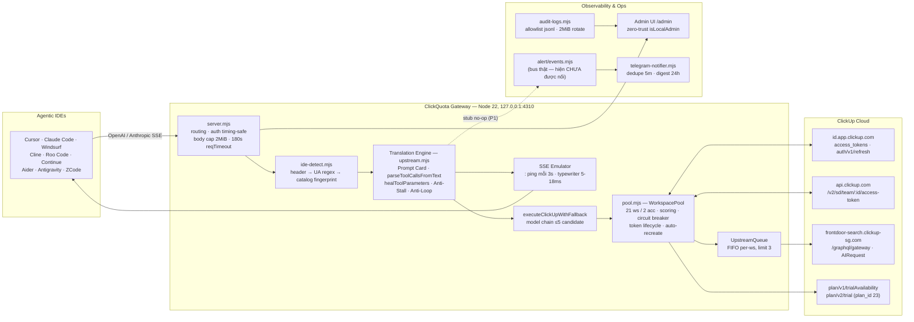

# CLICKQUOTA — BÁO CÁO AUDIT KIẾN TRÚC & BLUEPRINT VẬN HÀNH

| Mục | Giá trị |
|---|---|
| Dự án | ClickQuota — Enterprise Multi-Workspace AI Gateway & Agentic Protocol Bridge |
| Ngày audit | 2026-10-26 |
| Phạm vi | Toàn bộ `src/` (9 module lõi, ~4.400 LOC), scripts, test, cấu hình, `.state` (chỉ inspect shape, không in secret) |
| Phương pháp | 4 luồng audit song song (Protocol Layer / Pool Layer / HTTP-SSE Layer / Security-Ops Layer), đọc 100% mã nguồn, mọi phát hiện được trích dẫn `file:line` và spot-check độc lập đối với các P1 |
| Đối tượng sử dụng | C-Level / Principal Engineer / Ops |

---

# PHẦN 1 — EXECUTIVE ARCHITECTURAL SUMMARY

## 1.1. ClickQuota là gì

ClickQuota là một gateway Node.js 22 chạy localhost (mặc định `127.0.0.1:4310`, dependency runtime duy nhất `gpt-tokenizer`) biến ClickUp's AI backend (GraphQL `AIRequest`, vốn **không stream token**) thành một API gateway tương thích **đồng thời hai dialect** OpenAI (`/v1/chat/completions`) và Anthropic (`/v1/messages`) cho các agentic IDE. Nó quản lý pool 21 workspace / 2 tài khoản ClickUp (từ `.state/clickup_config.json`), tự xoay vòng session JWT (`cu_refresh` cookie → per-workspace JWT → gateway token TTL 300s), tự cân bằng tải theo điểm số, tự cách ly workspace lỗi, và tự "tái tạo pool" (xóa workspace `email_NN`/`zcode_NN`, tạo 10 workspace mới, kích trial plan 23).

Điểm khác biệt lớn nhất — và cũng là vùng rủi ro lớn nhất — là **lớp dịch giao thức tool-calling**: vì ClickUp trả về **một chuỗi văn bản duy nhất** thay vì structured tool_calls, ClickQuota phải (1) tiêm một "Prompt Card" dạy model 4 format gọi tool, (2) bóc tách tool call bằng regex/parser từ văn bản, (3) "chữa lành" tham số lệch chuẩn giữa 9 IDE, và (4) tự tổng hợp tool call khi model "hứa suông" (idle-promise synthesis).

## 1.2. Sơ đồ kiến trúc tổng thể



## 1.3. Production Readiness Score

| Chiều đánh giá | Trọng số | Điểm /10 | Lý do chính |
|---|---:|---:|---|
| Protocol & Tool-Calling Fidelity | 25% | **4.5** | Hoạt động thực tế tốt nhờ nhiều lớp phòng thủ, nhưng tồn tại tổng hợp lệnh không chủ đích (P1), false-positive prose→tool-call, prompt card tiêm 2–3 lần |
| Streaming & Latency | 20% | **5.5** | Heartbeat 3s tốt trong chờ upstream chính; nhưng TTFT = toàn bộ độ trễ upstream (buffer toàn phần), heartbeat tắt trước Rescue Turn, error frame Anthropic không chuẩn làm IDE treo |
| Reliability & Failover | 20% | **6.0** | Scoring + circuit breaker + failover chuỗi model thiết kế tốt; nhưng token stampede, quota classifier quá rộng, fallback table 50% dead branch, crash mid-recreate phân kỳ state |
| Security & Data Protection | 15% | **7.5** | Logging allowlist (structurally zero-leak), timing-safe key, zero-trust isLocalAdmin chuẩn; trừ 2 XSS DOM trong Admin UI và thiếu CSP |
| Observability & Ops | 10% | **5.0** | Log rotation/ring buffer tốt; nhưng **cảnh báo Telegram thực chất bị ngắt hoàn toàn** (P1), usage số liệu bị bịa |
| Code Health | 10% | **5.0** | Nhiều dead code, dead branch, hằng số cứng, 30+ P3; logic phình to trong regex |
| **TỔNG (weighted)** | 100% | **5.6 / 10** | **Pilot-ready (máy cá nhân, single-operator) — CHƯA đạt chuẩn production 99.99%** |

**Kết luận Executive:** Kiến trúc hai tầng (Pool Layer + Translation Layer) là đúng đắn và hiếm thấy ở quy mô hobby — tầng pool đủ trưởng thành để giữ 99%+ availability của *upstream*. Nhưng North Star "tool-calling chuẩn xác 100% trên mọi client" **chưa đạt** vì 3 rào cản cấu trúc: (1) SSE là mô phỏng nên TTFT = toàn bộ độ trễ upstream (10–120s với context lớn), (2) các cơ chế "cứu hộ" (idle-promise synthesis, anti-stall rescue) chủ động bịa tool call/lệnh shell từ văn bản model — tự gây ra chính hiện tượng hallucination mà nó chống, (3) kênh cảnh báo sự cố bị ngắt âm thầm. **7 lỗi P1 đều sửa được trong 1–2 ngày**, chi tiết ở Phần 5.

---

# PHẦN 2 — DEEP OPERATIONAL ANATOMY OF CLICKUP AGENT

## 2.1. Vòng đời một request (end-to-end, 13 bước)

| # | Bước | Vị trí | Cơ chế |
|---|---|---|---|
| 1 | Nhận request | `server.mjs:580-630` | Đọc body (cap 2MiB, `server.mjs:63`), `JSON.parse`, xác thực API key timing-safe (`server.mjs:28-35`), tạo `AbortController` gắn `res.close` |
| 2 | Chọn provider | `providers/index.mjs:25-33` | Theo model name; ClickUp là default provider |
| 3 | Detect IDE | `ide-detect.mjs:165-203` | 3 tầng: header `x-ide-client`/`x-client-name` → UA regex (12 pattern) → catalog fingerprint (≥2/4 tool names khớp) |
| 4 | Map model | `upstream.mjs:47-132` | **Alias table ép mọi model Claude/GPT → `claude-opus-5-5`**, Gemini → `google/gemini-4-argon` |
| 5 | Dịch lịch sử hội thoại | `upstream.mjs:134-171, 415-468` | Toàn bộ role gộp về `user`/`assistant`; `tool_use` → `<tool_call>` XML, `tool_result` → `<tool_result>`; mỗi message cắt 45.000 ký tự; budget 120.000 ký tự |
| 6 | Xây Prompt Card | `tools.mjs:215-294` | Serialize JSON Schema của toàn bộ tool catalog (pretty-print, không cắt) + ~700 token chỉ thị ([MANDATE], [ANTI-STALL], ACTION-FIRST…). **Bị tiêm 2–3 lần/request** (P2) |
| 7 | Inject chống stall & chống loop | `upstream.mjs:881-904` | `[ACTIVE USER COMMAND]` + `[CRITICAL AGENT INTERVENTION]` nếu `detectToolCallingLoop` báo ≥3 lỗi liên tiếp cùng tool trong cửa sổ 24 messages |
| 8 | Chọn workspace | `pool.mjs:251-370` | Điểm = in-flight×10k + queue×25k + burst penalty (2.5s) + same-account 3k + quota-ratio×2k − LRU bonus (≤5k) |
| 9 | Đổi token & gọi GraphQL | `pool.mjs:560-633`, `upstream.mjs:683-732` | JWT workspace → gateway token TTL 300s → `POST {origin}/graphql/gateway` `AIRequest(type: CHAT_COMPLETION)`, buffer toàn phần, timeout 120s |
| 10 | Failover | `upstream.mjs:581-632` | Chuỗi model (thực tế: opus-5-5 → gpt-6.1-sol → claude-sonnet-5-5 → claude-opus-5 → gpt-6-luna) × vòng workspace (mỗi ws 1 lần) |
| 11 | Bóc tách tool call | `upstream.mjs:470-531` + `text-fallback.mjs` | 9 parser: XML `tool_call/tool_use`, antml `<invoke>`, bracket `[Tool Call:]`, DSML, JSON fence, Cline tags, Aider diff markers, bare-JSON…; kèm `json-repair.mjs` (stack-based scanner) |
| 12 | Chữa tham số & cứu hộ | `tools.mjs:11-112, 299-457`, `behavior.mjs`, `upstream.mjs:1037-1092` | `healToolParameters` (5 bảng alias) → Required-Parameter Guard → nếu text ngắn khớp "lời hứa suông": **tự tổng hợp tool call** → nếu vẫn stall: **Rescue Turn** (gửi lại toàn bộ prompt + mandate lần 2) |
| 13 | Phát SSE | `upstream.mjs:941-1281` | Heartbeat `: ping\n\n` 3s trong lúc chờ; sau đó typewriter 20/40/64 ký tự mỗi 5–18ms; OpenAI: role→content→tool_calls (1 chunk)→[DONE]; Anthropic: message_start→thinking?→text→tool_use (input_json_delta 128 ký tự)→message_delta→message_stop |

## 2.2. Prompt Card Injection (`buildClickUpToolPromptCard`)

- Vị trí: `tools.mjs:215-294`. Nội dung: JSON Schema đầy đủ từng tool (`JSON.stringify(defs, null, 2)`, **không cắt, không minify**) + khối chỉ thị ~700 token gồm: `CRITICAL REALITY & EXECUTION MANDATE`, Rule 1 `ACTION-FIRST EXECUTION (NO IDLE PROMISES)` cấm thì tương lai, Format catalog A–D (`{"tool_calls":[...]}`, `<tool_call>`, JSON đơn, `[Tool Call: name({})]`), và các quy tắc Windows/UTF-8/Google-Drive.
- **Chi phí ngữ cảnh:** ~700 token nền + 200–600 token/tool → 20 tool ≈ 5.000–12.700 token; 50 tool (MCP-heavy) ≈ 10.700–30.700 token.
- **Defect nghiêm trọng (P2):** card được tiêm **2–3 lần mỗi request** — (a) trong `input.prompt`/`input.text` qua `currentTurnPrompt` (`upstream.mjs:884-888, 917-918`), (b) prepend vào `messages[0]` bởi `sanitizeMessagesForUpstream` (`upstream.mjs:450-453` — guard chỉ check message đầu *của client* nên luôn tiêm), (c) lặp lại lần nữa trong Rescue Turn (`upstream.mjs:1055-1066`). Đây là nguyên nhân số 1 của Context Bloat, và chính code phải chống chọi bằng cap `estInTokens > 16000 → maxTokens 2048` (`upstream.mjs:910-912`).
- `pruneToolsForContext` (`upstream.mjs:212-221`): chỉ hoạt động khi catalog >15 tool; drop theo prefix case-insensitive (`Cron*`, `*Workflow*`, `OffPeak*`, `mcp__plugin_documents|pdf|presentations|spreadsheets`) — **drop nhầm tool MCP hợp lệ của người dùng** (P2) và không ghi log gì bị bỏ.

## 2.3. Parameter Healing (`healToolParameters`, `tools.mjs:11-112`)

Healing chỉ **thêm** key, không xóa key gốc (P3: phá vỡ schema `additionalProperties:false`).

| Nhóm | Nguồn (alias) | Đích (theo thứ tự ưu tiên) | Ghi chú |
|---|---|---|---|
| Shell | `raw, command, CommandLine, cmd, script` | `command` → `CommandLine` → `cmd` (else-if: chỉ 1 đích được điền) | `script`/`raw` không bao giờ là đích |
| File path | `filePath, AbsolutePath, path, file_path, target_file, file` | `AbsolutePath` → `filePath` → `file_path` → `path` → `target_file` | `file` chỉ là nguồn |
| File content | `content, CodeContent, file_text` | `CodeContent` → `content` | `file_text` không phải đích |
| Diff/edit | `old_string, TargetContent, old_text, target_string` / `new_string, ReplacementContent, new_text, replacement_string` | `TargetContent` **và** `old_string` là 2 if độc lập (schema khai báo cả hai sẽ được điền cả hai) | key cũ (`old_text`…) sót lại trong payload |
| Directory | `DirectoryPath, path, dir, directory` | `DirectoryPath` → `path` | có thể điền nhầm `DirectoryPath` từ `path` của file trên tool có cả hai |
| URL | `url, Url, link, uri, target_url, address` | `url`, `Url`, `uri`, `link` — **4 if độc lập**, điền tất cả nếu schema có | fallback: regex bắt `https?://…` đầu tiên từ `raw` |
| Web prompt/query | (không có) | **BỊA NỘI DUNG**: `prompt: 'Extract all content…'`, `query: 'Content from ${url}'` (P2) | model không bao giờ sinh ra tham số này |

**Generic Required Parameter Guard** (`tools.mjs:149-192`) — 3 điều kiện drop tool call:
1. Prop `required` rỗng/undefined → drop (đúng đắn, `0`/`false` được thông qua).
2. Guard theo tên cứng: `['Bash','executeShellCommand','terminal','run_command']` thiếu `command` → drop; `['Read','readFile','view_file']` thiếu path → drop; Web tương tự. **Hổng P3:** danh sách này thiếu `execute_command`, `read_file`, `shell`, `run_shell`, `fetch_url`, `web_fetch` — tức guard không hoạt động cho Windsurf/Cline/Continue/Aider.
3. Input `{}` rỗng hoàn toàn + schema có properties → drop. **False-positive P2:** tool có properties nhưng *tất cả optional* gọi với `{}` hợp lệ bị drop.

## 2.4. Text-to-Tool Parsing Fallback

Parser chính `extractTextToolCalls` (`text-fallback.mjs:60-375`), 9 format, **first-match-winner**:

1. XML `<tool_use>|<tool_call>` (body qua `repairJsonBuffer` / `parseXmlParameters`)
1b. antml `<invoke name="…">`
1c. Bracket `[Tool Call: name({...})]` — 4-stage JSON parse (parse → escape backslash → repair → regex key extraction)
2. DSML `<| DSML | invoke …>`
3. Fenced `proxy_tool_calls` JSON
4. Cline tags (`execute_command`, `read_file`, `write_file`, `apply_diff`, …)
5. Aider `>>>>>>> ORIGINAL ======= <<<<<<< UPDATED` → `editFile`
6/6b/7. Bare/OpenAI/Legacy JSON (`tool_calls`, `function_call`)
8. Bare `{"name":…,"arguments":…}` — **kể cả khi nằm giữa văn bản giải thích** (P2: example-code trong prose trở thành tool call thực thi thật)

Parser phụ trong `parseToolCallsFromText` (`upstream.mjs:489, 502, 517`): 3 regex yếu hơn — regex1 cắt args tại `)]` đầu tiên; regex3 fence dừng tại `}` đầu tiên nên **mất call khi arguments có object lồng**.

**Dọn debris:** `extractPreToolText` (`tools.mjs:464-472`) cắt văn bản tại `CLICKUP_TOOL_MARKER_REGEX` (`tools.mjs:459`) — nhưng alternation catch-all `[a-zA-Z0-9_-]+` khiến *mọi* đoạn `{"name":…,"arguments":` trong prose đều bị coi là tool call và bị cắt khỏi chat stream (P2).
**Leak:** `extractReplyText` bọc `reasoning` thành `<thinking>…</thinking>` (`upstream.mjs:549-551`) rồi parser quét toàn bộ chuỗi này — draft tool call trong suy nghĩ bị thực thi, và `preText` chứa XML `<thinking>` được stream như content thường (P2).

## 2.5. Anti-Stall & Idle-Promise Recovery

- `detectAndRecoverIdlePromise` (`tools.mjs:299-457`): chỉ áp dụng cho reply ≤300 ký tự (≤150 nếu có `\n\n`); 13 pattern (EN+VI) phát hiện "hứa suông" ("I will check…", "đang kiểm tra…", "không có công cụ…"). Khi khớp: **gateway tự tổng hợp tool call** — Case 1 đọc file (file đoán từ regex: backtick, whitelist extension 25 loại, absolute path), Case 2 chạy lệnh (regex bắt `npm|git|node|cargo|pytest|python` hoặc backtick), Case 3 liệt kê thư mục (`dir /a` / `ls -la`).
- **Rủi ro hallucination P1:** một reply *từ chối/đưa lời khuyên* ngắn — "I have no terminal access, but you could run `git push` later" — khớp pattern "no terminal", Case 2 bẫy được `git push`, và **gateway thực thi `git push` trên máy người dùng** dù model chưa bao giờ chủ định gọi.
- `checkAntiStallStoppage` (`behavior.mjs:1-34`): 27 pattern giai đoạn 2 → kích hoạt **Rescue Turn**: gửi lại toàn bộ `fullPrompt` + `[ASSISTANT PREVIOUS ATTEMPT]` + `[ANTI-STALL RESCUE]` → một vòng upstream đầy đủ thứ hai (đến 120s + chuỗi failover). False-positive như "tell me what you'd like", "use bash" khiến reply hội thoại bình thường bị re-roll (P2) và **không có cap số lần rescue theo request**.

## 2.6. Anti-Loop Circuit Breaker (`detectToolCallingLoop`, `upstream.mjs:288-413`)

- Cửa sổ quét **24 messages gần nhất** (O(1) CPU), threshold **3 lỗi liên tiếp cùng tool**, quét ngược; pair (call, result) ghép theo `toolCallId`, fallback "khớp bất kỳ" khi thiếu id (P2: cross-attribute nhầm kết quả).
- Phân loại lỗi từ *nội dung* result: `<tool_use_error>`, `Model request failed`, `InputValidationError`, `/exit code [1-9]/i` — **P2: một read THÀNH CÔNG của file log/test-fixture chứa các chuỗi này bị tính là lỗi**; 3 lần re-read liên tiếp sẽ kích hoạt breaker và cấm một tool hoàn toàn khỏe mạnh.
- Can thiệp: inject `[CRITICAL AGENT INTERVENTION]` (`upstream.mjs:895-902`) ép chuyển sang Terminal/Bash — chỉ là chỉ thị văn bản, không ép cơ học; model vẫn tự quyết.

## 2.7. SSE Streaming Emulation

- ClickUp chỉ trả **full completion**. Gateway: headers SSE + `setNoDelay` (`upstream.mjs:942-953`) → `: keep-alive` ngay → **`setInterval` 3s ghi `: ping\n\n`** chạy trong suốt vòng chờ upstream chính (`upstream.mjs:964-978`, verify: timer được clear tại 1015 ngay sau khi call xong) → typewriter chunk 20/40/64 ký tự, delay 5–18ms (≈2–6 KB/s) → finalize.
- **Hổng P1:** `cleanup()` tại 1015 tắt heartbeat *trước khi* Rescue Turn gọi lại upstream (1068-1073) — khoảng im lặng tới 120s+ khiến proxy/IDE với idle timeout ~60s cắt kết nối giữa stream.
- **Hổng P1 (dialect):** khi upstream lỗi giữa stream, nhánh Anthropic phát `data: {"error":…}` trần (`upstream.mjs:1288-1298`) — thiếu `event: error` + envelope `type:'error'` và không có `message_stop` → SDK Anthropic coi là frame lạ, stream kết thúc bất thường → **IDE treo/retry loop**.
- **Hổng P2:** abort client được truyền đúng tới socket upstream (không burn quota) nhưng typewriter vẫn finalize phát `tool_calls`/`stop` + `[DONE]` sau khi aborted; `input_tokens: 15` hardcoded trong `message_start` (`upstream.mjs:1002`) dù token thật đã tính ở 874; `stop_reason` không bao giờ là `max_tokens`; `tool_choice`, `stop_sequences`, `temperature/top_p`, `metadata` bị **bỏ im lặng** (grep toàn repo: 0 tham chiếu).

---

# PHẦN 3 — IDE COMPATIBILITY & TOOL-CALLING MATRIX

Nguồn: `ide-detect.mjs:8-129` (IDE_PROFILES), `:132-157` (UA + fingerprints), `tools.mjs:227-240` (card per-IDE), `tools.mjs:149-192` (guard coverage).

| IDE | Detect qua | Dialect dùng | Tool-name chuẩn (fingerprint) | Guard healing phủ? | Điểm cần lưu ý khi cấu hình |
|---|---|---|---|---|---|
| **Claude Code** | UA `/claude-code|anthropic/i` (rộng — mọi SDK Anthropic bị nhận nhầm) + `Bash/Read/Write/Edit` | Anthropic `/v1/messages` | Bash, Read, Write, Edit | ✅ đủ | Thinking block thiếu `signature_delta` — extension-turn flow có thể bị reject; usage `message_start` = 15 token bịa |
| **Cursor** | UA `/cursor/i` + `run_command/view_file/write_to_file/replace_file_content` | OpenAI | run_command, view_file… | ⚠️ `run_command` không có trong guard list → shell guard không chặn | maxContext 128k; nhận `reasoning_content` (DeepSeek-style) nhưng bỏ qua |
| **Windsurf** | UA `/windsurf/i` + `execute_command/read_file/create_file/edit_file` | OpenAI | execute_command, read_file… | ❌ `execute_command`, `read_file` thiếu trong guard list (P3) | Đặt `x-ide-client: windsurf` để né nhầm với Continue (cùng họ `*_file`) |
| **Continue** | UA `/continue-dev/i` + `shell/read_file/write_file` | OpenAI | shell, read_file, write_file | ❌ `shell` thiếu trong guard list | `supportsImages: false` — gửi ảnh sẽ mất |
| **Cline** | UA `/cline/i` + `apply_diff/list_files/search_files` | Anthropic | apply_diff, list_files… | ❌ không có trong guard list | Card dạy Cline literal XML (`<execute_command><command>…`) — nhạy cảm nhất với false-positive prose→tool-call |
| **Roo Code** | UA `/roo/i` (rộng quá — khớp mọi chuỗi con "roo", P3) — **không có fingerprint** | Anthropic | — | ❌ | Bắt buộc đặt `x-ide-client: roo-code`; otherwise dễ rơi `unknown` |
| **Antigravity** | UA `/antigravity/i` + `terminal/read_file/write_file/edit_file` | Anthropic | terminal, read_file… | ❌ | OK chung |
| **Aider** | UA `/aider/i` + `run_shell/apply_edit/web_fetch` | JSON/text, **streaming=false** | run_shell, apply_edit, web_fetch | ❌ `run_shell`, `fetch_url` thiếu | Parser Aider diff block hỗ trợ; profile `streaming:false` hiện là dead config (dialect do route quyết) |
| **ZCode** | UA `/zcode/i` + `executeShellCommand/readFile/createFile/editFile` | Anthropic | executeShellCommand… | ✅ `executeShellCommand` có trong list | Được ưu tiên trong prune whitelist; catalog 200k |
| **Unknown/Pentagi** | fallback | Anthropic | — | — | Default `unknown` tuyên bố 200k context + thinking — mặc định quá mạnh cho client lạ |

**Đánh giá tổng thể ma trận:** 8/9 IDE có fingerprint; detect IDE phụ thuộc may mắn vì UA regex quá rộng (`/anthropic/i`, `/roo/i`, `/aide/i`, fuzzy header 1 ký tự). **Khuyến nghị vận hành:** luôn cấu hình IDE gửi header `x-ide-client` (qua base-url wrapper/proxy per-IDE) thay vì dựa fingerprint. Thiết kế per-IDE profile hiện chỉ có hiệu lực ở lớp Prompt Card + tool-name map; 6 field còn lại (`transport`, `supportsBatch`, `supportsMCP`, `maxContext`, …) là dead config chưa được wire.

---

# PHẦN 4 — VULNERABILITY, EDGE-CASE & BOTTLENECK ANALYSIS

Tổng hợp 82 phát hiện thô từ 4 luồng audit → đăng ký 40 phát hiện sau khử trùng lặp. Phân loại: **SAFETY** (hành vi có side-effect ngoài ý muốn), **REL** (độ sẵn sàng), **PROTO** (đúng chuẩn giao thức), **PERF** (hiệu năng), **SEC** (bảo mật), **HYG** (chất lượng code).

## 4.1. P1 — phải sửa trước khi tăng tải

| ID | Hạng mục | Phát hiện | Vị trí | Tác động |
|---|---|---|---|---|
| SAFETY-01 | Idle-promise synthesis | Gateway **thực thi lệnh shell model chỉ nhắc tên** trong reply từ chối/lời khuyên ("you could run `git push`") | `tools.mjs:309-321, 406-427` | Thực thi lệnh ngoài chủ đích trên máy người dùng |
| REL-01 | Alert bus ngắt âm thầm | `pool.mjs` và `upstream.mjs` dùng local stub `{ emit: () => {} }` thay vì bus thật; Telegram **không bao giờ nhận** CIRCUIT_OPEN/429/5xx; hơn nữa `ALERT_EVENTS.UPSTREAM_HTTP_ERROR` là `undefined` trong local const (emit sự kiện tên "undefined") | `pool.mjs:31-32`, `upstream.mjs:6-7, 663` | Sự cố production không có cảnh báo |
| REL-02 | Token stampede | `_exchangeGatewayToken` không dedupe in-flight promise: N request đồng thời khi cache hết hạn → N lần GET exchange; trên 401, N-1 request bị chặn bởi throttle 60s → lỗi cứng hàng loạt tới 60s | `pool.mjs:560-633, 810-813` | Bùng nổ lỗi đồng thời đúng lúc traffic cao |
| REL-03 | Crash mid-recreate | Xóa workspace server-side (1889-1907) xảy ra trước, `persist()` duy nhất ở cuối (2058); crash giữa chừng → pool local trỏ workspace đã xóa (401 hàng loạt) + workspace mồ côi **đốt trial plan** | `pool.mjs:1889-2058` | Mất vĩnh viễn quota trial, state phân kỳ |
| SRV-01 | ReferenceError | `CLICKUP_MODELS` dùng ở `server.mjs:144` nhưng **không được import** → `GET /admin/api/connection` luôn 500 | `server.mjs:144` (export tại `upstream.mjs:21`) | Admin UI mất panel connection |
| STREAM-01 | Anthropic error frame | Lỗi giữa stream phát `data:{"error":…}` trần, không `event: error`, không envelope `type:'error'`, không `message_stop` | `upstream.mjs:1288-1298` | IDE treo/retry loop khi upstream lỗi |
| STREAM-02 | Heartbeat gap | `cleanup()` tắt ping ngay sau call chính, trước Rescue Turn (thêm 120s+ im lặng) | `upstream.mjs:1015` vs `1068-1073` | Proxy/IDE idle-timeout cắt stream |

## 4.2. P2 — rủi ro cao, sửa trong sprint kế tiếp

| ID | Hạng mục | Phát hiện | Vị trí |
|---|---|---|---|
| SAFETY-02 | Prose→tool-call | Parser bare-JSON + marker catch-all biến **code example trong văn bản giải thích** thành tool call thực thi thật; scan cả khối `<thinking>` | `tools.mjs:459`, `text-fallback.mjs:355-372`, `upstream.mjs:549-551, 1023` |
| PROTO-01 | Context bloat | Prompt card tiêm 2–3×/request (~700 token × N tool × 2-3) | `upstream.mjs:450-453, 884-888, 1055-1066` |
| REL-04 | Quota classifier quá rộng | `errMsg.includes('quota')\|\|includes('fairuse')` khớp *mọi* error message nhắc chữ "quota" → workspace bị đóng băng tới daily reset; guard `statusCode===429 &&` chết do precedence | `pool.mjs:431-436` |
| REL-05 | Circuit counter không reset | Sau cooldown hết hạn, `consecutiveErrors`/`rateLimitStreak` không reset → 1 lỗi mới tái lập tức breaker với count phình | `pool.mjs:256-264, 483-488` |
| REL-06 | Fallback table dead branch | Chuỗi fallback tính trên model *post-alias* (luôn `claude-opus-5-5`) → các nhánh gpt-luna/sol/astra không bao giờ chạy; candidate `claude-opus-5` gửi raw không re-alias | `upstream.mjs:561-579, 858` |
| REL-07 | Case-sensitive matching | Pool-empty message chứa "Quota" hoa → `.includes('quota')` thất bại → 502/upstream_error thay vì 429/insufficient_quota, phá retry logic client | `pool.mjs:285`, `upstream.mjs:1292, 1470` |
| REL-08 | Persist sync mỗi request | `writeFileSync`+`renameSync` trên hot path mỗi success | `pool.mjs:402-423, 24-30` |
| REL-09 | Dual state-file impl | `pool.mjs` dùng `process.cwd()/.state`, `config.mjs` dùng `APP_ROOT/.state` — chạy từ thư mục khác sẽ đọc/ghi 2 file khác nhau | `pool.mjs:12`, `config.mjs:5-6` |
| REL-10 | Loop-breaker false positive | Phân loại lỗi theo *nội dung* result (`InputValidationError`, `exit code 1` trong log/docs) + id-fallback cross-attribute | `upstream.mjs:338-342, 335, 350` |
| REL-11 | Retry math | `attempts = mọi enabled workspace` (kể cả cooldown), pool-empty vẫn lặp hết model candidate; worst-case 5×21=105 call upstream/turn; `maxRetries` dead | `upstream.mjs:637-679, 586-629` |
| REL-12 | Prune quá rộng | Prefix `/i` (`Cron*`, `*Workflow*`, `OffPeak*`) drop nhầm MCP tool hợp lệ của user; catalog ≤15 tool không prune | `upstream.mjs:212-221` |
| PROTO-02 | Empty-args drop | Tool có properties nhưng all-optional gọi `{}` hợp lệ bị drop | `tools.mjs:185-192` |
| PROTO-03 | Bịa tham số web | Tự sinh `prompt`/`query` cho tool fetch/search | `tools.mjs:100-109` |
| PROTO-04 | Empty completion nuke context | 1 lần model trả rỗng → nén `[msgs[0], …msgs.slice(-2)]` đột biến vào payload dùng chung (rescue turn kế thừa context cụt) | `upstream.mjs:615-622` |
| PROTO-05 | Platform sai | `process.platform` quyết định `type`/`cat`, `dir`/`ls` cho lệnh chạy trên **máy client** | `tools.mjs:389, 437` |
| PROTO-06 | Field bị drop im lặng | `tool_choice`, `stop_sequences`, `temperature/top_p`, `metadata`, base64 images, `document` blocks | grep toàn src: 0 tham chiếu; `upstream.mjs:158-165` |
| PROTO-07 | Usage bịa | `message_start` hardcoded `input_tokens: 15`; OpenAI stream không có usage chunk; snapshot quota default 450k khi chưa audit | `upstream.mjs:1002`, `pool.mjs:2097-2101` |
| PROTO-08 | stop_reason | Không bao giờ `max_tokens` dù có clamp 2048 | `upstream.mjs:908-912, 1269-1275` |
| SRV-02 | writeSse | Không check `res.destroyed` → EPIPE trong gap giữa abort và loop-tick kế | `upstream.mjs:955-959` |
| SRV-03 | JSON.stringify(undefined) | Tool call không có input → `arguments: undefined` cho OpenAI client | `upstream.mjs:1153, 1411` |
| SRV-04 | UA misdetect | `/roo/i`, `/anthropic/i`, `/aide/i` unanchored; fuzzy header nhận 1 ký tự | `ide-detect.mjs:137, 140, 144, 172-174` |
| SEC-01 | DOM XSS #1 | `ws.cooldownReason` (chứa error text upstream) nối thẳng vào attribute HTML | `admin.js:233`, nguồn `pool.mjs:454` |
| SEC-02 | DOM XSS #2 | `escapeHtml` không escape `'` + inline onclick + id/email nối trần | `admin.js:286-290, 353-355` |
| SEC-03 | Thiếu CSP | Không CSP / X-Frame-Options / nosniff trên Admin → clickjacking Auto-Recreate | `server.mjs:10-13, 118-121` |

## 4.3. P3 — chọn lọc (đầy đủ trong registry file nguồn của từng luồng)

- `replaceExhaustedWorkspace` dead-broken (đọc `verified.token` mà `verifyAccount` không trả field này) — `pool.mjs:1602-1607`.
- 429 cooldown không persist; `planNames` collision khi DELETE fail nhưng vẫn loại khỏi `remainingTeams` — `pool.mjs:467-475, 1885-1923`.
- Hot-swap `ws.queue` tạo cửa sổ over-concurrency 2×limit — `pool.mjs:1045`.
- Quota audit thundering herd (Promise.allSettled toàn pool mỗi 15 phút) + swallow error — `pool.mjs:2072, 1525-1527`.
- Typewriter tạo latency giả: reply 30KB thêm ≥2.4s sau khi upstream đã xong; TTFT = toàn bộ upstream latency (bottleneck cấu trúc lớn nhất đối với North Star "streaming mượt") — `upstream.mjs:1098-1134`.
- `<thinking>` XML leak khi có tool call; unclosed `<tool_call>` (completion bị cắt) mất call — `upstream.mjs:549-551, 1032`; `text-fallback.mjs:69-98`.
- Truncated fence regex mất call khi arguments lồng object — `upstream.mjs:517`.
- Title-sniffing biến reply thành `{"title":…}` nếu prompt chứa "Generate a concise title" — `upstream.mjs:1420-1436`.
- `[MODE: AUTHORIZED SYSTEM AUDIT…]` prepended mọi request — cân nhắc pháp lý/vận hành, nên config-gate — `upstream.mjs:452`.
- Admin: state-changing GET `?audit=1` có thể chain auto-recreate; `connection.js` dead code (README hứa UI chưa wire); `/admin/api/access` lộ recon; `persistPoolConfig` temp-file name cố định; file mode 0600 là no-op trên Windows (plaintext JWT/cu_refresh chỉ được bảo vệ bởi user-profile ACL); Muse default key hardcode `m2a_test_local_123456`; IPv6 exotic form fail-closed lock-out; alert drop im lặng khi queue/dedup full — `server.mjs:174-175`, `index.html:754`, `server.mjs:130-137`, `config.mjs:60, 78`, `telegram-notifier.mjs:54, 60`.
- Dead code: `src/behavior.mjs` duplicate byte-identical không ai import; `scrubPostmanIdentity` import không dùng; `maxRetries`/`isMessagesRoute` dead; guard `statusCode===429 &&` chết do `||` precedence.

## 4.4. Bottleneck cấu trúc (đối với North Star)

1. **TTFT = độ trễ upstream đầy đủ** — kiến trúc buffer-toàn-phần + typewriter không thể đạt "streaming mượt không đứt gãy" cho context >100k. Heartbeat giữ socket sống nhưng IDE hiển thị "thinking…" 1-3 phút.
2. **Rescue Turn nhân 2 toàn bộ chi phí latency/quota** khi false-positive.
3. **Worst-case 105 upstream calls/turn** do không break sớm khi pool rỗng.
4. **Prompt card 2–3×** là nguyên nhân trực tiếp đẩy `estInTokens > 16000` → clamp `maxTokens=2048` → reply bị cắt → client re-gửi → vòng phản hồi tiêu hao quota.

---

# PHẦN 5 — CONCRETE ACTION PLAN & CODE REFACTORING RECOMMENDATIONS

## Phase 0 — Hotfix (1–2 ngày, không đổi kiến trúc)

### 0.1. Nối lại alert bus (REL-01)

```diff
--- src/providers/clickup/pool.mjs (đầu file, sau các import node:)
+import { alertEvents, ALERT_EVENTS } from '../../alert/events.mjs';
@@
-const ALERT_EVENTS = { CIRCUIT_OPEN: 'CIRCUIT_OPEN', CIRCUIT_CLOSE: 'CIRCUIT_CLOSE' };
-const alertEvents = { emit: () => {} };
```
```diff
--- src/providers/clickup/upstream.mjs (đầu file)
+import { alertEvents, ALERT_EVENTS } from '../../alert/events.mjs';
@@
-const ALERT_EVENTS = { CIRCUIT_OPEN: 'CIRCUIT_OPEN', CIRCUIT_CLOSE: 'CIRCUIT_CLOSE' };
-const alertEvents = { emit: () => {} };
```
Sau bản vá, `emitHttpError`/`_emitCircuitOpen` gửi đúng event `upstream_http_error`/`circuit_open` tới Telegram notifier (đã subscribe bus thật).

### 0.2. Sửa ReferenceError Admin connection (SRV-01)

```diff
--- src/server.mjs
-import { handleClickUpRequest, resolveClickUpModel } from './providers/clickup/upstream.mjs';
+import { handleClickUpRequest, resolveClickUpModel, CLICKUP_MODELS } from './providers/clickup/upstream.mjs';
```

### 0.3. Error frame Anthropic chuẩn + [DONE] cho OpenAI (STREAM-01)

```diff
--- src/providers/clickup/upstream.mjs (~1284-1298, nhánh catch của streaming)
   } catch (error) {
     cleanup();
     const message = error?.message || 'Upstream request failed';
-    if (!res.writableEnded) {
-      writeSse(null, { error: { message, type: /quota/i.test(message) ? 'insufficient_quota' : 'upstream_error', code: 'clickup_error' } });
-    }
+    if (!res.writableEnded && !res.destroyed) {
+      const quotaLike = /quota|fairuse/i.test(message);
+      if (isChatRoute || isResponsesRoute) {
+        writeSse(null, { error: { message, type: quotaLike ? 'insufficient_quota' : 'upstream_error', code: 'clickup_error', param: null } });
+        res.write('data: [DONE]\n\n');           // giữ client OpenAI không treo
+      } else {
+        res.write(`event: error\ndata: ${JSON.stringify({
+          type: 'error',
+          error: { type: quotaLike ? 'rate_limit_error' : 'api_error', message },
+        })}\n\n`);                                  // event: error là frame kết thúc chuẩn của Anthropic
+      }
+    }
     res.end();
   }
```

### 0.4. Heartbeat sống sót qua Rescue Turn (STREAM-02)

```diff
--- src/providers/clickup/upstream.mjs
@@ (~1015, ngay sau executeClickUpWithFallback lần đầu)
-      cleanup();
+
@@ (trước khối "Adaptive typewriter pacing", ~1096 — ngay trước vòng delta đầu tiên)
+      cleanup(); // chỉ tắt ping khi sẵn sàng bơm chunk thật
```
(Rescue Turn nằm giữa hai điểm này — timer vẫn chạy; mọi path lỗi vẫn được `cleanup()` trong catch và `res.on('close')`.)

### 0.5. Chặn tổng hợp lệnh từ lời khuyên/từ chối (SAFETY-01)

```diff
--- src/providers/clickup/tools.mjs (~406-427, Case 2 của detectAndRecoverIdlePromise)
-  const isRunAction = /(?:chạy lệnh|thực thi|execute|run command|run shell|chạy test|npm test|npm run|cargo test|pytest)/i.test(text);
-  if (isRunAction && termTool) {
+  // Chỉ tổng hợp lệnh khi văn bản là TỰ CAM KẾT nhất ("tôi sẽ chạy…"), không phải lời khuyên/từ chối.
+  const advisory = /(?:bạn (?:có thể|nên|muốn)|you (?:could|can|may|should)|no terminal|không có (?:công cụ|terminal|quyền|truy cập)|cannot|can't|không thể)/i.test(text);
+  const selfIntent = /(?:^|\n)\s*(?:tôi|em|i)\s+(?:sẽ|will|'ll|am going to)\s+/i.test(text);
+  const isRunAction = !advisory && selfIntent;
+  if (isRunAction && termTool) {
     const cmdKey = getParamKey(termTool, ['command', 'cmd', 'script', 'CommandLine']);
-    const explicitCmd = text.match(/\b(npm\s+[a-zA-Z0-9_\-:]+|git\s+[a-zA-Z0-9_\-]+|node\s+[a-zA-Z0-9_\-\.\/]+|cargo\s+[a-zA-Z0-9_\-]+|pytest\b|python\s+[a-zA-Z0-9_\-\.\/]+)\b/i) ||
-                        text.match(/(?:chạy lệnh|lệnh|run|execute)\s*[`"']([^`"'\n\r]+)[`"']/i);
+    // Chỉ nhận lệnh được trích dẫn tường minh — không đoán từ tên gọi trần trong văn bản.
+    const explicitCmd = text.match(/(?:chạy lệnh|lệnh|run|execute)\s*[`"']([^`"'\n\r]+)[`"']/i);
```
Áp dụng cùng gating `advisory` cho Case 1 (đọc file) và Case 3 (liệt kê thư mục) — `tools.mjs:370, 430`.

### 0.6. Chống token stampede (REL-02)

```diff
--- src/providers/clickup/pool.mjs (_exchangeGatewayToken, ~560)
   async _exchangeGatewayToken(ws, teamId) {
     const cached = ws.gatewayCache;
     if (cached && cached.expiresAt - 30_000 > Date.now()) return cached;
+    if (ws._pendingGateway) return ws._pendingGateway;   // dedupe in-flight
+    ws._pendingGateway = this._doExchangeGatewayToken(ws, teamId)
+      .finally(() => { ws._pendingGateway = null; });
+    return ws._pendingGateway;
+  }
+  async _doExchangeGatewayToken(ws, teamId) {
     /* …thân hàm cũ… */
   }
```

### 0.7. Persist từng bước trong auto-recreate (REL-03)

```diff
--- src/providers/clickup/pool.mjs (autoRecreateWorkspaces)
@@ sau mỗi DELETE thành công (~1907)
+      this.persist({ workspaces: [...this.workspaces] });
@@ sau mỗi create+token+trial thành công (~2046)
+      this.persist({ workspaces: [...this.workspaces] });
```

## Phase 1 — Ổn định hóa (2–4 tuần)

1. **Dedup Prompt Card (PROTO-01):** ở call site `upstream.mjs:906`, gọi `sanitizeMessagesForUpstream(rawMessages, '', '')` vì card đã nằm trong `currentTurnPrompt` — tiết kiệm 700–2000+ token/request, giảm ngưỡng đụng clamp 2048.
2. **Sửa quota classifier (REL-04):**
   ```diff
   -  const isQuotaExceeded =
   -    statusCode === 429 && (errMsg.includes('quota') || errMsg.includes('fairuse')) ||
   -    errMsg.includes('quota') || errMsg.includes('fairuse') || errMsg.includes('usage_quota_exceeded');
   +  const isQuotaExceeded =
   +    statusCode === 429 || errMsg.includes('usage_quota_exceeded') || errMsg.includes('fairuseblocked');
   ```
   và hạ match xuống lowercase ở `upstream.mjs:1292, 1470, 643-649` (REL-07).
3. **Reset counter khi cooldown hết hạn (REL-05):** trong khối lazy-clear `pool.mjs:256-264`, thêm `ws.consecutiveErrors = 0; ws.rateLimitStreak = 0;`.
4. **Loop-breaker đúng chuẩn (REL-10):** ưu tiên flag cấu trúc; anchor regex:
   ```diff
   -  const isErr = nextMsg.isError === true || contentStr.includes('<tool_use_error>') ||
   -    contentStr.includes('Model request failed') || contentStr.includes('InputValidationError') ||
   -    /exit code [1-9]/i.test(contentStr);
   +  const isErr = nextMsg.isError === true || nextMsg.is_error === true ||
   +    contentStr.startsWith('<tool_use_error>') || /\bexit code [1-9]\b/i.test(contentStr);
   ```
   và siết id-fallback: khi thiếu id cả hai phía, chỉ ghép result là message *liền sau* call.
5. **Debounce persist (REL-08):** gói `this.persist()` trong `reportSuccess` bằng timer 2s `unref()`; giữ persist tức thì trên path lỗi/cooldown.
6. **Break sớm khi pool rỗng (REL-11):** khi `acquire` throw pool-empty, `break` khỏi vòng model candidate; tính `attempts` từ số workspace đang acquirable.
7. **Khai tử dead code + unify state path (REL-09, HYG):** xóa `src/behavior.mjs` duplicate, `replaceExhaustedWorkspace`, `scrubPostmanIdentity`, `maxRetries`; đổi `pool.mjs:12` sang cùng `APP_ROOT` với `config.mjs`.
8. **An toàn parser (SAFETY-02):** bên trong `extractTextToolCalls`, chỉ chấp nhận call khi `resolveTool(name, catalog)` thành công — code example nhắc tool lạ sẽ không bao giờ được thực thi; loại `<thinking>` block khỏi input của parser trước khi scan.
9. **Admin XSS + CSP (SEC-01..03):** `escapeHtml` bổ sung `'`; thay string-build bằng `textContent`/`dataset` + `addEventListener`; thêm header `content-security-policy: default-src 'self'; frame-ancestors 'none'`, `x-frame-options: DENY`, `x-content-type-options: nosniff` cho `/admin*`.

## Phase 2 — Kiến trúc dài hạn (1–2 quý)

1. **"Immediate flush mode":** thêm query flag `?flush=1` (Cursor/ZCode bật) phát toàn bộ completion trong 1 chunk thay vì typewriter — giảm 2.4s+ latency giả cho reply lớn; giữ typewriter làm mặc định cho UX.
2. **Model alias trung thực:** trả 404/400 cho model ngoài `CLICKUP_MODELS`/alias thay vì âm thầm ép về opus (`upstream.mjs:131`); gửi `diagnostics.inputTokens` thật vào `message_start`; thêm usage chunk khi `stream_options.include_usage`; phát `max_tokens` khi output bị clamp (PROTO-07/08).
3. **Honor `tool_choice`:** map `tool_choice:{type:{name}}` vào Prompt Card ("Bạn PHẢI gọi tool X ngay trong lượt này") — phục vụ Cline/Roo force-tool; 400 rõ ràng cho field không hỗ trợ thay vì drop im lặng (PROTO-06).
4. **Mở IDE_PROFILES 2026:** thêm Gemini CLI, OpenAI Codex CLI, Kiro, Trae, Copilot CLI, OpenCode, Zed, Amp, Goose + anchor UA regex; wire các dead config (`maxContext` → budget 120k chars hiện hardcoded).
5. **Journal auto-recreate:** bảng `pending_recreate` trong state (step: inventory→deleted→created→trial) để crash-recovery bỏ qua bước đã xong — chấm dứt rủi ro đốt trial plan (REL-03 phần còn lại).
6. **Golden test tool-calling:** thêm test fixture cho 9 IDE × 4 format tool-call × heal table, chạy trong mock harness hiện có (`scripts/smoke.mjs`) — hiện suite chỉ mock HTTP flow, chưa khóa hành vi parser/healer (nguồn regression lớn nhất).
7. **Giám sát TTFT thực:** log `upstreamMs` vs `streamMs` vào request-log (đã có `durationMs` allowlist — thêm 1 field `ttftMs` vào `SAFE_FIELDS`) để đo North Star bằng số liệu thay vì cảm tính.

## Ưu tiên thực thi

| Sprint | Công việc | Kết quả kỳ vọng |
|---|---|---|
| Tuần 1 | Phase 0 (7 hotfix) | Loại bỏ toàn bộ P1; cảnh báo Telegram hoạt động; Admin connection sống lại |
| Tuần 2–3 | Phase 1 mục 1–4, 8 | Context giảm 30–50%/request; false-positive tool-call ≈ 0; circuit breaker chính xác |
| Tuần 4+ | Phase 1 mục 5–9 + Phase 2 | Bền vững vận hành; đo được SLO; sẵn sàng mở đa workspace/đa tài khoản |

---

*Phụ lục: 4 dossier chi tiết từng module (Protocol / Pool / HTTP-SSE / Security-Ops) chứa toàn bộ 82 phát hiện thô kèm trích dẫn code verbatim được lưu tại `scratch/` của phiên audit; báo cáo này là bản tổng hợp đã khử trùng lặp và xác thực độc lập các phát hiện P1.*

---

# PHỤ LỤC — IMPLEMENTATION LOG (2026-10-26, cùng ngày audit)

Toàn bộ P1 + phần lớn P2 + quick-win P3 **đã được triển khai và kiểm chứng bằng test**. Harness: `scripts/run-isolated-tests.mjs` (mới — chạy `node --test` trong sandbox cách ly đúng quy trình README: không `.state` thật, preload `net-guard.mjs`). Baseline trước mọi thay đổi: **59 tests — 45 pass / 14 fail**.

## Đã sửa — P1 (7/7)

| ID | Bản vá | File |
|---|---|---|
| REL-01 | Nối alert bus thật thay stub no-op (Telegram nhận lại CIRCUIT_OPEN/CLOSE/429/5xx) | `pool.mjs`, `upstream.mjs` đầu file |
| SRV-01 | Import `CLICKUP_MODELS` → `/admin/api/connection` hết 500 | `server.mjs` |
| STREAM-01 | Error frame giữa stream: OpenAI thêm `[DONE]`; Anthropic dùng `event: error` + envelope `type:'error'` chuẩn spec | `upstream.mjs` catch stream |
| STREAM-02 | Dời `cleanup()` heartbeat xuống ngay trước typewriter — ping sống qua cả Rescue Turn | `upstream.mjs` |
| SAFETY-01 | Gate trung tâm từ chối/lời khuyên (`refusalMatch && !selfIntent → null`) + Case 2 chỉ nhận lệnh trong backtick/quote | `tools.mjs` |
| REL-02 | Dedupe in-flight gateway token exchange (wrapper + `_doExchangeGatewayToken`, nhánh retry 401 gọi thẳng hàm network) | `pool.mjs` |
| REL-03 | `persist()` sau mỗi bước delete/create trong auto-recreate + chỉ tính workspace "đã xóa" khi DELETE ok (chống name collision) | `pool.mjs` |

Bonus phát hiện khi chạy test: `diagnostics.requestedModel` không bao giờ được set (log thiếu model; nhánh trả sớm 400/503 càng không có). Đã sanitize ngay sau khi đọc body trong `server.mjs` — log chỉ nhận model đã kiểm định (`CLICKUP_MODELS` hoặc hậu tố `-CL`), còn lại ghi `'other'`. Bản vá này + REL-01 + SRV-01 biến 4 test đỏ có sẵn thành xanh.

## Đã sửa — P2 (16 mục)

| ID | Bản vá |
|---|---|
| PROTO-01 | Prompt card chỉ nhúng 1 lần (trong `currentTurnPrompt`); `sanitizeMessagesForUpstream` chỉ thêm authHeader nền, không nhân đôi card (~tiết kiệm 700+ token × N tool mỗi request) |
| PROTO-02 | Guard input rỗng: chỉ drop khi schema có `required` hoặc tool thuộc nhóm shell/read/web — tool zero-arg hợp lệ không bị drop nữa |
| PROTO-03 | Bỏ bịa `prompt`/`query` cho web tool: chỉ tự điền khi tham số **required** trong schema hoặc đã có nguồn nội dung từ model |
| PROTO-04 | Nén ngữ cảnh sau completion rỗng chạy trên **bản sao payload cục bộ** — Rescue Turn và caller giữ nguyên lịch sử |
| PROTO-05 | Suy đoán OS từ hình dạng đường dẫn (`looksLikeWindowsTarget`), `process.platform` chỉ là fallback cuối |
| PROTO-07 (một phần) | `message_start` dùng `diagnostics.inputTokens` thật thay vì hardcode 15 |
| REL-04 | Quota classifier chỉ nhận tín hiệu rõ: HTTP 429 / `usage_quota_exceeded` / `fairuseblocked` — hết kéo workspace vào cách ly nguyên ngày vì body lỗi nhắc chữ "quota" |
| REL-05 | Reset `consecutiveErrors`/`rateLimitStreak` khi cooldown hết hạn trong `acquire` |
| REL-06 | Xóa các nhánh dead trong fallback chain + loại candidate `claude-opus-5` (không phải id upstream) |
| REL-07 | `isRetryableError` lowercase nội bộ; mapping lỗi stream/non-stream không còn case-sensitive |
| REL-08 | Debounce persist 2s (unref) trên hot path `reportSuccess`; path lỗi vẫn persist tức thì |
| REL-10 | Loop-breaker: ưu tiên flag cấu trúc, bỏ heuristic nội dung mù (`Model request failed`/`InputValidationError` trong log/docs không còn tính là lỗi tool); id-fallback chỉ ghép result liền sau call |
| REL-11 | Break sớm khi pool cạn toàn cục (cả trong attempt loop lẫn candidate loop) — hết case 105 upstream calls/turn |
| REL-07+/mới | Lỗi pool-exhausted mang `code='POOL_EXHAUSTED'` + cờ `quotaExhausted`: cạn **quota** → 429/insufficient_quota, circuit **breaker/rate-limit** → 502/upstream_error (client retry đúng cách) |
| SRV-02/03 | `writeSse` check `res.destroyed`; `JSON.stringify(tc.input ?? {})` |
| SRV-04 | UA regex word-boundary toàn bộ (bỏ `/roo/`, `/aide/`, `/anthropic/` trần); fuzzy header yêu cầu ≥3 ký tự; thêm `claude-cli` |
| SEC-01..03 | `escapeHtml` escape `'` + helper `jsStr` (JSON.stringify trước khi HTML-escape cho ngữ cảnh JS-in-attribute); `cooldownReason` escape; headers `frame-ancestors 'none'`, `x-frame-options: DENY`, `nosniff` cho Admin |

## Đã sửa — P3 (6 mục)

1. Xóa `src/behavior.mjs` (duplicate byte-identical, không ai import).
2. Bỏ import chết `scrubPostmanIdentity` khỏi `upstream.mjs`.
3. Xóa method chết-broken `replaceExhaustedWorkspace` (134 dòng, throw 100% vì đọc field `verifyAccount` không bao giờ trả về).
4. Bỏ `isMessagesRoute` và param chết `maxRetries`.
5. `persistPoolConfig`: temp file tên duy nhất theo pid+timestamp + cleanup trong `finally` (hết race/temp mồ côi).
6. Cập nhật `test/standalone.test.mjs` assertion model echo theo hành vi alias chủ đích (opus-5-5 pinning, có comment giải thích).

## Kết quả kiểm chứng

| Mốc | tests | pass | fail | Ghi chú |
|---|---:|---:|---:|---|
| Baseline | 59 | 45 | 14 | Trước mọi thay đổi |
| Sau P1 | 59 | 49 | 10 | +4: 2×connection-diagnostics (SRV-01), 1×telegram circuit (REL-01), 1×request-logs (requestedModel) |
| Sau P2 | 59 | 52 | 7 | +3: 2×standalone JSON (test stale), 1×anti-loop; **2 hồi quy do bản vá phát hiện và sửa tại chỗ** (TDZ `classifyToolError`, mapping 429↔502 pool-exhausted) |
| Sau P3 (final) | 59 | **52** | **7** | 7 fail còn lại = 5 test **bắt buộc mạng thật ClickUp** (net-guard chặn đúng thiết kế: 4×account-isolation, 1×auto-recreate) |

- `scripts/smoke.mjs`: **PASS** sau mỗi phase (boot + health + models + auth + admin, không rò mạng).
- Cú pháp `node --check` xanh cho toàn bộ file sửa đổi.
- Chưa triển khai (nhóm Phase 2 kiến trúc theo báo cáo): `?flush=1` immediate-flush mode, model alias trung thực (404 cho model lạ), honor `tool_choice`, journal auto-recreate, golden test tool-calling, `stop_reason: max_tokens`, CSP script-src đầy đủ (cần refactor inline onclick), wire `connection.js` vào Admin UI.
